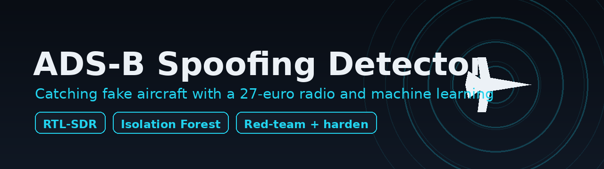
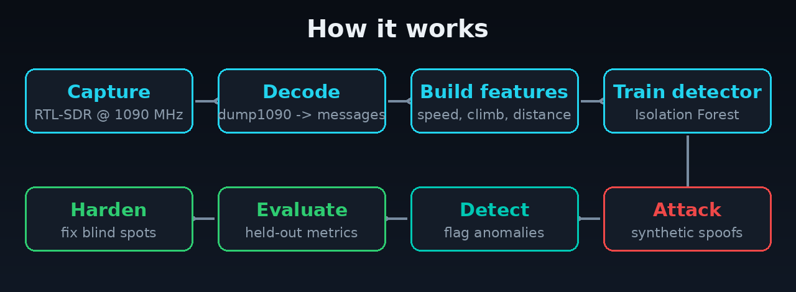
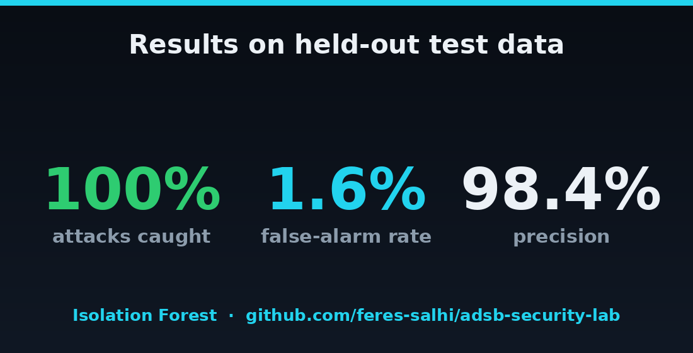
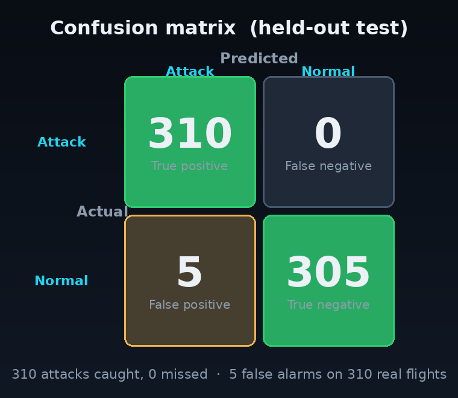
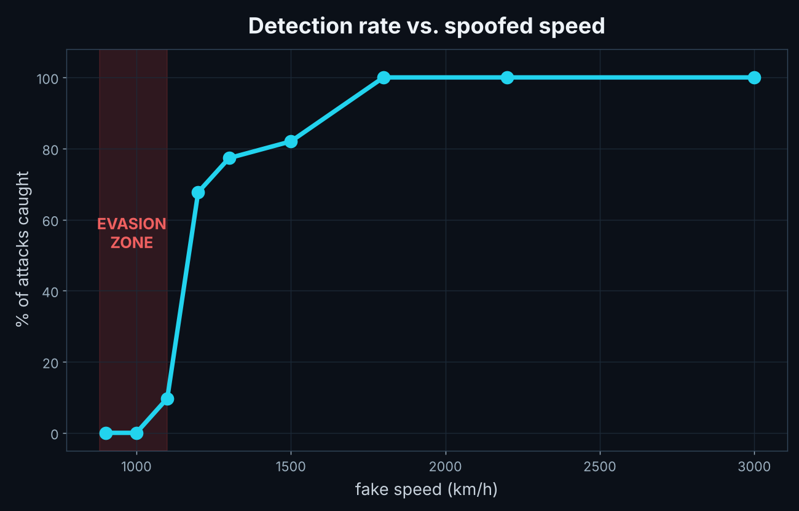
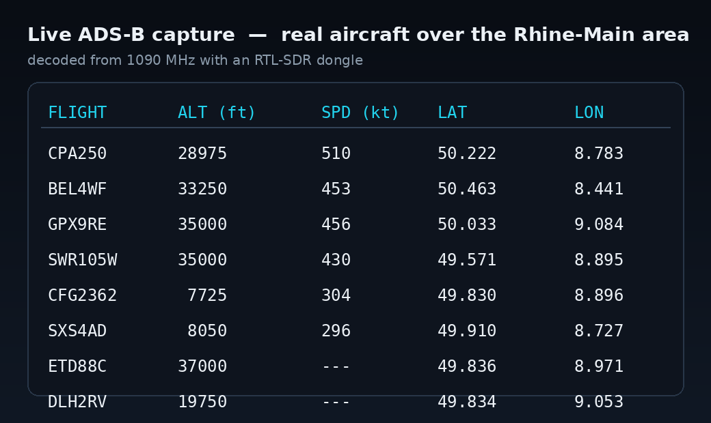
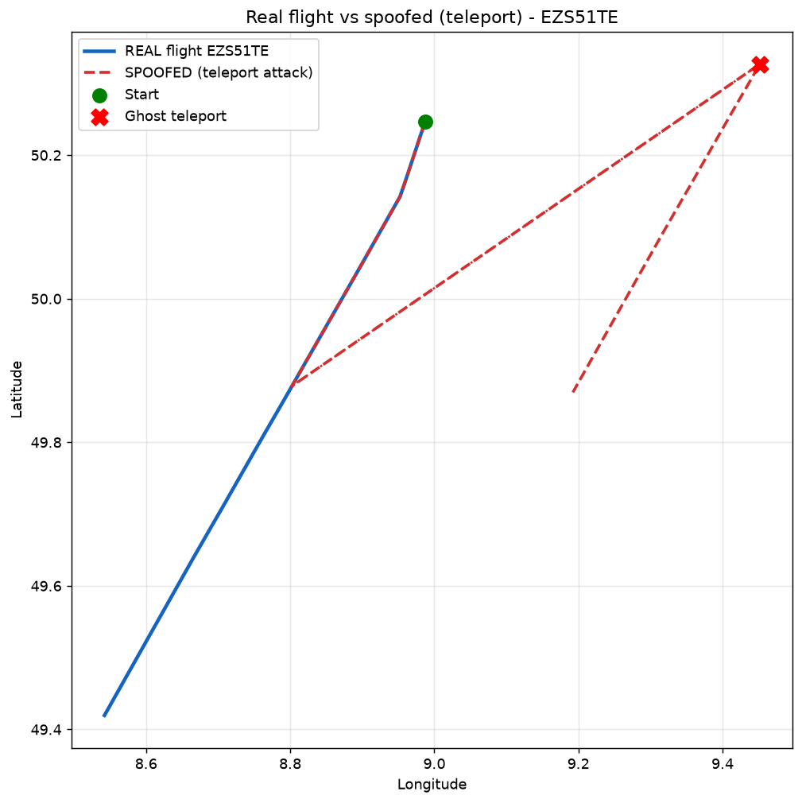
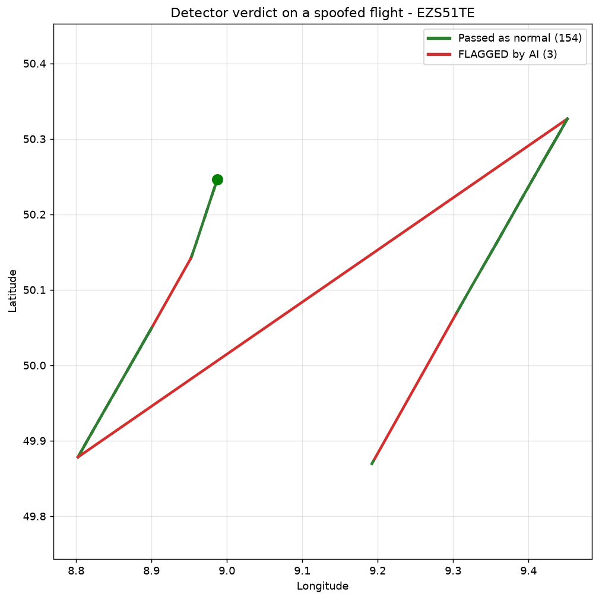

# ADS-B Spoofing Detector


> I captured **live aircraft signals** with a 27-euro software-defined radio, trained a machine-learning model to recognise normal flight, built a detector for **spoofed (fake) aircraft** — then red-teamed it to find exactly where it breaks.

Everything here runs end-to-end on data I captured myself.

---

## TL;DR

- Captured **live ADS-B** traffic over the Rhine-Main area with a **27-euro RTL-SDR** dongle.
- Trained an **unsupervised anomaly detector** (Isolation Forest) on real flight *movement* — ground speed, climb rate, step distance.
- **Red-teamed** it with synthetic spoofing attacks: teleports, impossible speeds, altitude jumps.
- **100% detection · 1.6% false-alarm rate · 98.4% precision** on a held-out test set.
- **Stress-tested to failure:** found an evasion gap below ~1100 km/h and over-sensitivity to altitude changes — both traced back to cruise-heavy training data.

---

## The problem

Every aircraft continuously broadcasts its identity, position, speed and altitude over an open radio protocol — **ADS-B**, on 1090 MHz. These broadcasts are **unauthenticated and unencrypted**: anyone with cheap hardware can forge them, injecting "ghost" aircraft or faking a plane's position. It is a well-known, still-unsolved weakness in aviation.

This project builds a **detection layer**. It cannot stop fake signals from being transmitted — but it can flag, in real time, when the data defies physics.

---

## How it works



The pipeline is fully reproducible from a single receiver:

1. **Capture** — an RTL-SDR dongle listens on 1090 MHz; `dump1090` decodes the raw bursts into ADS-B messages.
2. **Build features** — messages are grouped into per-aircraft tracks, and each movement step is reduced to three physics-grounded features: **ground speed (km/h)**, **climb rate (ft/s)** and **step distance (km)**.
3. **Train** — an **Isolation Forest** learns the shape of *normal* flight from real data, unsupervised (no labelled attacks required).
4. **Attack** — synthetic spoofing attacks are generated in software (never transmitted) and thrown at the detector.
5. **Evaluate & harden** — performance is measured on held-out data, weaknesses are surfaced by stress-testing, and the feature set is hardened.

---

## Results



Measured on a **held-out test set the model never saw during training**:

| Metric | Result |
| --- | --- |
| Detection rate (synthetic attacks) | **100%** (310 / 310) |
| False-alarm rate (real flights) | **1.6%** (5 / 310) |
| Precision | **98.4%** |



### Red-team → harden

The first version wrongly flagged a normal **climbing** aircraft. Root cause: the altitude feature used the raw altitude *change* and ignored the time gap — climbing 1,500 ft over 30 s is normal, over 3 s is impossible, but the feature could not tell them apart. Switching to **climb rate (ft/s)** removed the false alarm while keeping every attack caught. Finding and fixing that is the whole point of red-teaming your own system.

### Where it breaks (honest limits)



Stress-testing with progressively subtler attacks exposed two real limitations:

- **Speed** — fakes **below ~1100 km/h** (inside the observed real-speed range) **evade** detection; it only becomes reliable above ~1800 km/h.
- **Altitude** — the detector is **over-sensitive**, flagging even mild climbs, so it would false-alarm on real climbing or descending aircraft.

Both trace back to the **training data**: captures were dominated by high-altitude *cruise* traffic, so the model knows cruise speed well but rarely saw altitude changes. This is a data-coverage problem, not a model flaw — and understanding *why* it breaks matters more than a clean 100%.

---

## See it running

**Real aircraft, decoded live from 1090 MHz:**



**A real flight vs. a spoofed (teleporting) copy — and the detector's verdict painted onto each track segment:**

| Real vs. spoofed | Detector verdict |
| --- | --- |
|  |  |

Green = passed as normal, red = flagged. The red jump is the impossible ~65 km teleport.

---

## Methodology

- **Data** — a short live capture over the Rhine-Main area produced tens of thousands of raw ADS-B messages; after decoding and cleaning, **~35 aircraft trajectories** and **1,549 movement steps**.
- **Observed "normal"** — cruise speed median ≈ 834 km/h (max ≈ 1,088); climb rate median 0, 95th percentile ≈ 27 ft/s.
- **Model** — `IsolationForest` (200 trees, 2% contamination) over `[speed_kmh, climb_rate_fps, dist_km]`.
- **Attacks (software only, never broadcast)** — teleport / impossible speed, ghost jump, altitude teleport, hypersonic, and graduated subtle speed/altitude spoofs.

---

## Repository structure

```
adsb-security-lab/
├─ assets/     figures used in this README
├─ data/       captured tracks + engineered features
├─ models/     trained detector (detector.joblib)
├─ proof/      raw result outputs
└─ src/
   ├─ capture.py           tap live decoded data (dump1090 port 30003)
   ├─ build_tracks.py      group messages into per-aircraft tracks
   ├─ explore.py           summarise a capture
   ├─ features.py          turn tracks into movement features
   ├─ train.py             train the Isolation Forest detector
   ├─ attack_test.py       fire hand-crafted spoofs at the detector
   ├─ evaluate.py          held-out metrics (detection / false alarm / precision)
   ├─ subtle_test.py       ramp up subtle attacks to find breaking points
   ├─ viz_plot.py          plot real vs. spoofed flight
   └─ detector_overlay.py  colour each path segment by the detector's verdict
```

---

## Getting started

Prerequisites: a genuine RTL-SDR dongle (RTL2832U + R820T2), the [Zadig](https://zadig.akeo.ie) driver, [`dump1090`](https://github.com/MalcolmRobb/dump1090), and Python 3.

```bash
pip install -r requirements.txt

# 1) decode live ADS-B (serves data on port 30003)
dump1090.exe --interactive --net --device-index 1

# 2) capture, process, train
python src/capture.py           # Ctrl+C to stop
python src/build_tracks.py
python src/features.py
python src/train.py

# 3) attack, evaluate, stress-test
python src/attack_test.py
python src/evaluate.py
python src/subtle_test.py

# 4) visualise
python src/viz_plot.py
python src/detector_overlay.py
```

---

## Tech stack

`Python` · `scikit-learn` (Isolation Forest) · `NumPy` · `Matplotlib` · `folium` · `dump1090` · `RTL-SDR`

## Limitations & future work

- Single receiver → local, line-of-sight coverage; tracks are partial segments, not full flights.
- Speed evasion gap below ~1100 km/h and altitude over-sensitivity, both from cruise-heavy data.
- Synthetic attacks are rule-generated, not replayed from real incidents.
- **Next:** capture varied flight phases (climb / descent, lower altitudes) to broaden "normal"; a sequence model (per-track, not per-step); a physics / plausibility cross-check layer.

## Ethical & legal note

Fully **receive-only** — the radio cannot transmit, and all spoofing is simulated in software and **never broadcast**. Passive reception of open ADS-B broadcasts for research is legal in Germany; transmitting on these bands is not.

## Author

**Fares Salhi** — B.Sc. Computer Science, TU Darmstadt. Focused on AI & AI security.

## License

Released under the MIT License — see [LICENSE](LICENSE).
